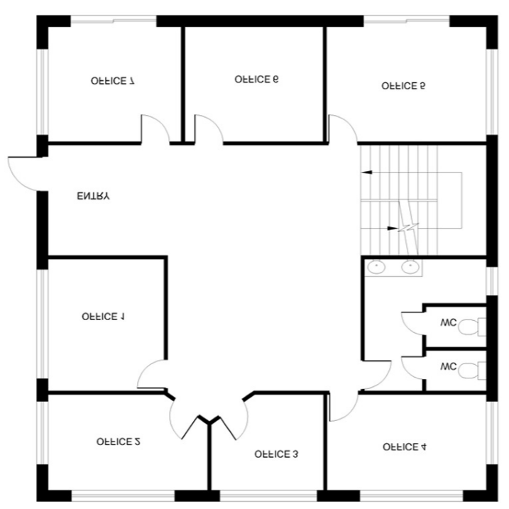
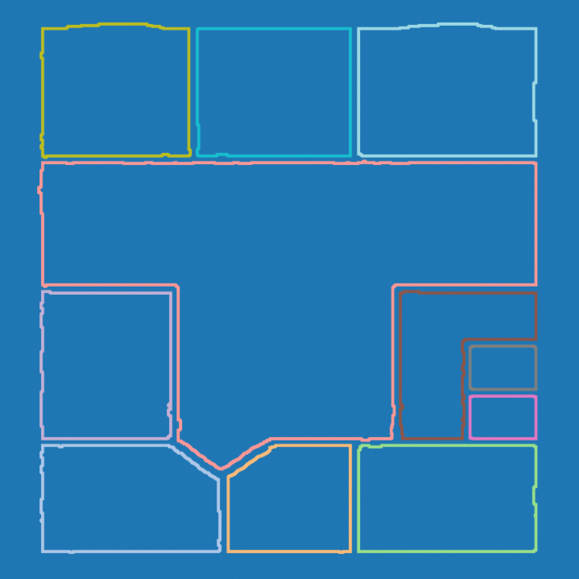
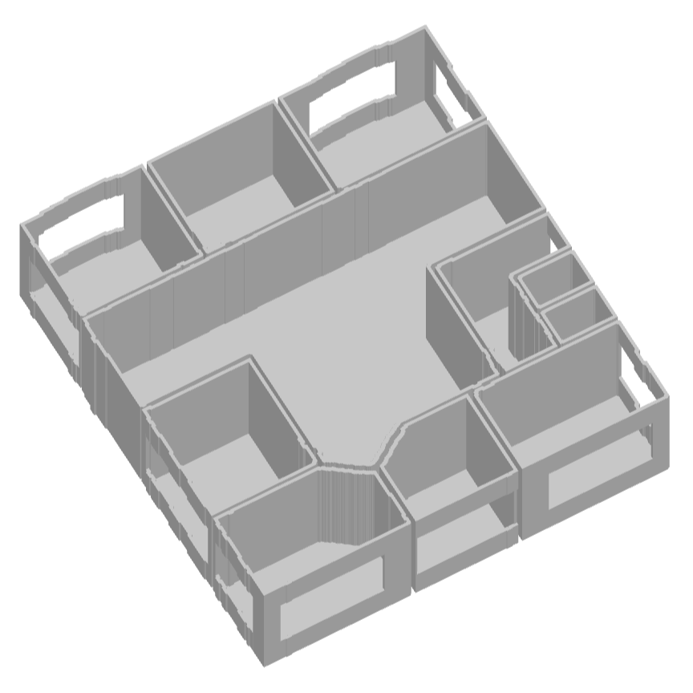
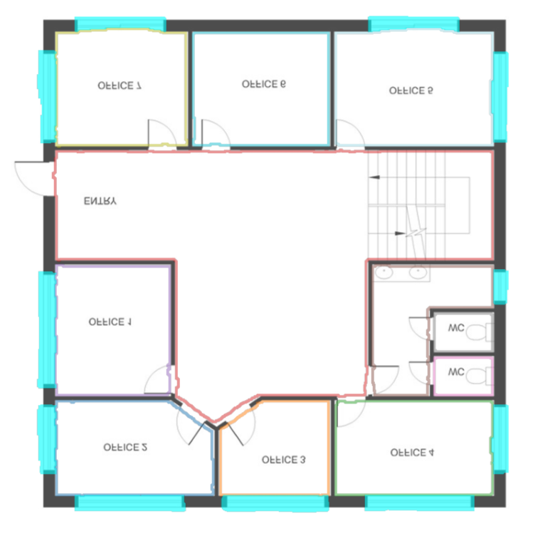

# Floor Plan to 3D Pipeline

This project is a comprehensive solution for converting 2D floor plan images into interactive 3D models. It utilizes deep learning for semantic understanding and morphological image processing for 3D geometry generation.

## Pipeline Visualization

The following images demonstrate the complete workflow from floor plan input to 3D model output:

### Original Floor Plan

*Input floor plan with labeled offices and rooms*

### Semantic Segmentation Output

*Colored segmentation map showing detected rooms and structural elements*

### 3D Extruded Model

*Final 3D model with extruded walls and room structure*

### Overlay Visualization

*Floor plan with color-coded segmentation overlay showing pipeline processing*

## Project Structure

The project is organized into three main modules:

1.  **SplitFloor**: A deep learning module responsible for detecting structural elements (Walls, Doors, Windows).
2.  **SemaFloor**: A deep learning module dedicated to detecting room boundaries and habitable areas.
3.  **ForgeFloor**: The core pipeline that orchestrates the neural networks, processes the geometric data, and extrudes the final 3D model.

## Installation

Ensure you have Python 3.8+ installed. Install the required dependencies:

```bash
pip install torch torchvision numpy matplotlib opencv-python pillow pyvista scikit-image tqdm pandas albumentations scipy scikit-learn
```

*Note: A CUDA-capable GPU is recommended for training and fast inference.*

## Usage

The main entry point for the pipeline is located in the `ForgeFloor` directory.

### Graphical User Interface (GUI)

To launch the interactive application with live preview:

```bash
python ForgeFloor/extruder.py --gui
```

### Command Line Interface (CLI)

To process an image automatically:

```bash
python ForgeFloor/extruder.py --input path/to/floorplan.jpg --auto --output_dir outputs/
```

## Workflow

1.  **Input**: A raw 2D floor plan image (JPG/PNG).
2.  **Inference**: 
    *   `SplitFloor` extracts structural masks (walls, windows, doors).
    *   `SemaFloor` extracts room masks.
3.  **Processing**: `ForgeFloor` cleans the masks using morphological operations.
4.  **Extrusion**: The cleaned 2D data is extruded into 3D meshes.
5.  **Output**: A 3D OBJ model, visualization overlays, and segmentation CSVs.
