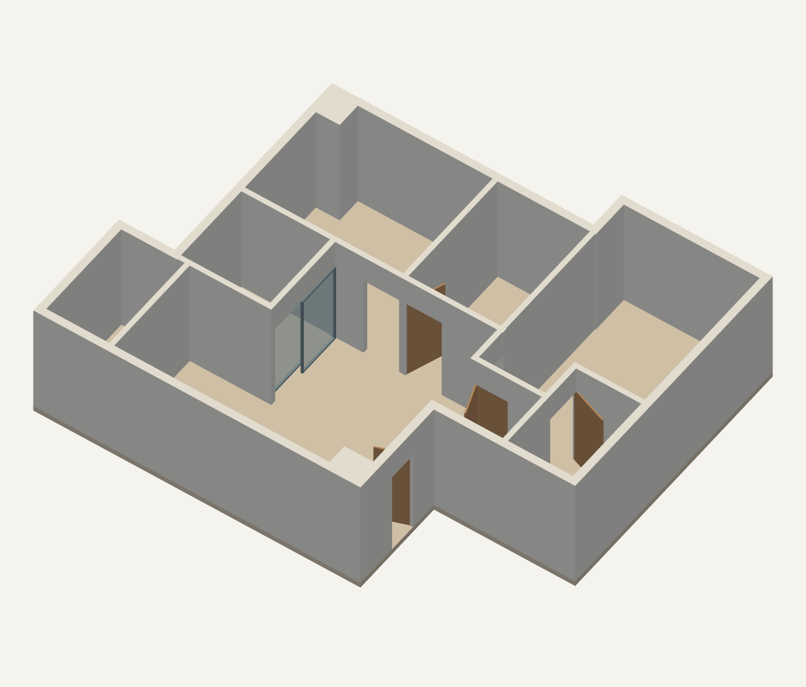

# 户型三维示意模型

根据上传的平面图核对墙线和门位置建立。自动分割曾把背景方格误识别为 62 个房间区域，因此本示例交付的是校正后的模型。



- [下载 GLB 模型](model/floorplan.glb)
- [下载完整模型包](model/floorplan-model.zip)
- [OBJ 几何](model/floorplan.obj)及[配套材质](model/floorplan.mtl)
- [俯视图](model/top-view.png)与[模型检查记录](model/model-info.json)

`input.png` 是原始上传图片；`traced-plan.json` 保存核对的墙中心线、门位置和建模假设。

原图无尺寸标注，以约 68 像素的门符号暂按 0.90 米换算，墙高 2.80 米、门高 2.10 米。这是按图中比例建立的示意模型。两处交叉方框暂按全高结构块保留；左侧错开的双线按推拉隔断解释，玻璃材质仅用于展示。

模型包含 6 处平开门和 1 处推拉隔断。已逐处检查门洞贯通、门楣保留及网格闭合，并重新读取 GLB 验证导出。GLB 使用 Y 轴向上，OBJ 使用 Z 轴向上；两者单位均为米，采用相同的估算比例。

从仓库根目录复现：

```bash
python -m pip install -r requirements-model-lock.txt
python scripts/build_traced_plan.py
```

重新生成的文件保存在 `outputs/user-floorplan-2026-11-06/reviewed/`，不会自动覆盖本目录的模型快照。
